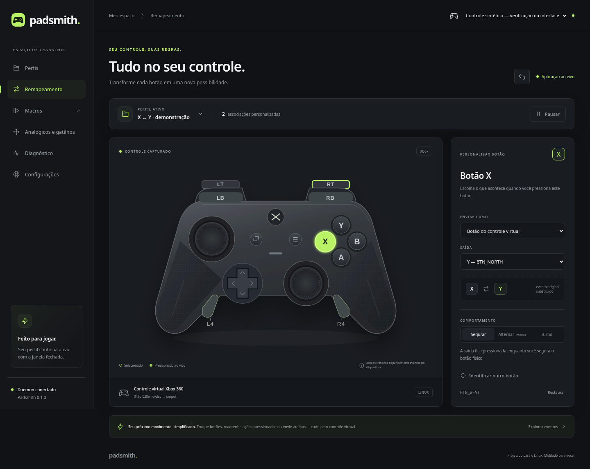

# Padsmith

Remapeamento de controles para Linux, em Rust. O daemon independente da interface
captura evdev e cria um gamepad virtual com identidade Xbox 360 (`045e:028e`), além
de teclado e mouse virtuais. Interface em português, Tauri 2 e Svelte/TypeScript.

O contexto detalhado para agentes OpenCode fica em
`.opencode/skills/padsmith-project/SKILL.md` e é descoberto automaticamente ao abrir
este repositório.

## NixOS

Veja [instalação e trechos exatos para seu flake e módulos](docs/nixos.md).

```sh
nix develop
nix build 'path:.#default'  # daemon, CLI, interface e entrada no menu
```

## AppImage

Para gerar um arquivo que inclui interface, daemon e CLI:

```sh
nix develop
build-appimage
```

O comando `build-appimage` fica disponível no ambiente deste projeto e já inclui
Podman. Também é possível executar `nix develop --command build-appimage`.
O build grava o resultado em `target/appimage/`.
Veja [como gerar e usar o AppImage](docs/appimage.md), incluindo execução no
NixOS e as permissões necessárias para o controle.

## Desenvolvimento e testes

O motor em `crates/core` não acessa hardware nem relógios: cada transição recebe
estado, evento e tempo monotônico explícito. O adaptador Linux fica em
`crates/linux`; daemon, CLI e protocolo IPC são crates separados.

Na raiz do repositório, entre em `nix develop` antes dos comandos abaixo. O shell
fornece as bibliotecas GTK/WebKit/libudev e gera o ícone PNG a partir do SVG.
Também configura `LD_LIBRARY_PATH` para a biblioteca AppIndicator, que a bandeja
carrega dinamicamente em tempo de execução, e inclui os schemas GSettings em
`XDG_DATA_DIRS`, necessários para o WebKitGTK calcular corretamente a escala da
tela. Sem esses schemas, a interface pode aparecer comprimida mesmo com o CSS
carregado corretamente.

```sh
cargo test --workspace
cargo clippy --workspace --all-targets -- -D warnings
pnpm --dir ui install --frozen-lockfile
pnpm --dir ui build
# Integração real com o kernel, sem controle físico, requer /dev/uinput e uaccess:
cargo test -p padsmithd --test uinput -- --ignored --nocapture --test-threads=1
```

Os dois testes de integração criam controles sintéticos, iniciam daemons restritos
a essas fontes, injetam eventos e leem as saídas virtuais. Conferem X ↔ Y, toggle,
macros, gravação, pausa, retomada, hotplug, vários controles, perfis independentes,
troca por processo `.exe` sintético e liberação de grabs após SIGTERM/SIGKILL.
A distribuição de latência uinput → daemon → uinput é medida com hotplug em paralelo.
O daemon padrão ignora os nomes reservados desses fixtures; instâncias antigas
precisam ser encerradas para não disputarem os controles de teste.

Para desenvolver a interface, em outro terminal dentro de `nix develop`:

```sh
cargo run -p padsmithd  # primeiro terminal; não execute junto de outro daemon
cargo tauri dev       # segundo terminal; inicia o frontend Svelte
```

Para compilar e executar a interface em release, dentro de `nix develop`:

```sh
pnpm --dir ui install --frozen-lockfile
pnpm --dir ui build
cargo build --release --workspace --features padsmith-ui/custom-protocol
./target/release/padsmith-ui
```

`padsmith` é a CLI; `padsmith-ui` abre a janela. O daemon `padsmithd` precisa estar
ativo para remapear, mas não inicie outra instância se ele já estiver rodando.
O executável gerado diretamente pelo Cargo deve ser aberto dentro de `nix develop`;
o pacote Nix configura o ambiente de execução por meio de um wrapper.

O pacote Nix usa `rustPlatform.buildRustPackage`, `cargo-tauri.hook`,
`fetchPnpmDeps` e `pnpmConfigHook`. `packages.daemon` também permite compilar
somente daemon/CLI. Confira o [roteiro de validação](docs/validacao.md).

## Interface



*Prévia com eventos sintéticos de teste; não comprova eventos do controle físico.*

- Controle vetorial interativo, com L4/R4 visíveis, iluminação por eventos e painel
  lateral de remapeamento. A associação de traseiros exige observar um evento.
- Perfis, macros, analógicos/gatilhos, diagnóstico e configurações na navegação.
- Editor de macros com timeline arrastável, alternativa por setas e gravação.
- Tema claro/escuro/sistema, rótulos Xbox/PlayStation/Nintendo, desfazer e edição
  ao vivo. A base de dicionários de i18n fica em `ui/src/lib/i18n.ts`.
- Fechar a janela mantém a bandeja; **Sair da interface** encerra a GUI e preserva
  o daemon. O menu da bandeja permite abrir, pausar e escolher perfil por controle.

## Uso pela CLI

```sh
padsmith devices
padsmith doctor
padsmith doctor --no-probe  # não testa EVIOCGRAB
padsmithd                 # ou o serviço de usuário fornecido pelo módulo
padsmith status
padsmith monitor          # Ctrl+C encerra apenas o monitor
padsmith profile import examples/swap-xy.toml
padsmith profile apply swap-xy
padsmith pause
padsmith resume
padsmith profile export swap-xy ./meu-perfil.toml
```

`padsmith doctor` testa brevemente grab/ungrab dos nós não gerenciados para detectar
`EBUSY`. O kernel não informa qual processo é dono do grab. Abrir um dispositivo
sem grab (por exemplo `gamepad-desktop-guard`) não é uma captura exclusiva.
O comando abre hidraw somente para conferir acesso; não lê relatórios nem envia
comandos ao firmware.

## Perfis

Um arquivo TOML por perfil em `~/.config/padsmith/profiles/` (ou
`$XDG_CONFIG_HOME/padsmith/profiles/`). Edições são observadas com inotify,
validadas antes da aplicação e rejeitadas com aviso se inválidas. O arquivo
`assignments.toml` armazena a associação entre ID físico e perfil.
Também é salva uma associação pela conexão USB/interface para recuperar o perfil
quando a troca de modo altera VID/PID. Identificadores e conexão são verificáveis
por `padsmith devices --json`; sem identidade/topologia estável, uma nova associação
pode ser necessária. O protocolo IPC é versionado: atualize daemon, CLI e GUI juntos.

Os nomes são posicionais: Xbox X = `BTN_WEST`, Y = `BTN_NORTH`, A = `BTN_SOUTH`,
B = `BTN_EAST`. A troca de layout altera a apresentação, não esses nomes.
Na saída Xbox 360, o adaptador traduz X/Y para a ABI histórica do driver `xpad`:
X sai como `BTN_X` (alias Linux `BTN_NORTH`, código 307) e Y como `BTN_Y`
(alias `BTN_WEST`, código 308). Os destinos dos perfis continuam posicionais;
não use o nome evdev da saída virtual para deduzir a posição no controle físico.
Botões não configurados passam para seu equivalente virtual quando fazem parte
do conjunto padrão; códigos extras precisam de associação explícita. Nós irmãos
usam códigos qualificados, como `touchpad:BTN_LEFT`.
Gatilhos digitais `BTN_TL2`/`BTN_TR2` e d-pad digital são convertidos aos eixos
padrão do Xbox. Destinos `kind="trigger"` e `kind="dpad"` permitem mapear/toggle
dessas saídas. Códigos de tecla desconhecidos preservam um nome numérico
`KEYCODE_xxx`, permitindo mapear também entradas extras fora dos nomes conhecidos.

Veja `examples/swap-xy.toml` e `examples/desktop.toml`. Os eixos aceitam inversão,
destino (inclusive troca de analógicos), deadzone e curva exponencial. `mode =
"keys"` com limiar transforma eixos/gatilhos/d-pad em teclas ou botões;
`mode = "mouse"` transforma um eixo em `REL_X` ou `REL_Y`, com velocidade em
pixels/segundo. Não há polling de evdev: mouse contínuo usa um temporizador apenas
enquanto o analógico está deslocado (atualizações de movimento a 125 Hz).

## Jogos, camadas e atalhos

`processes = ["meu-jogo.exe", "jogo-linux"]` ativa o perfil quando um nome de
executável corresponder. Aceita `*` e `?`, sem diferenciar maiúsculas. A inspeção
de `/proc` ocorre a cada 1 s em trabalho separado, incluindo nomes `.exe` presentes
na linha de comando do Wine/Proton; não há polling de input. `priority` desempata
perfis, e `devices` pode restringir um perfil automático a IDs/padrões específicos.
A escolha manual prevalece até mudar o perfil de jogo reconhecido; ao sair do
jogo, o perfil manual é restaurado. Notificações usam a sessão D-Bus do usuário.

Camadas contêm `activation`, `buttons`, `axes` e `priority`. Enquanto o ativador é
segurado, associações da camada prevalecem e o restante é herdado do mapa base.
A troca cancela macros/toggles e reavalia botões/eixos ainda segurados, liberando
os destinos anteriores. Edite as camadas em Configurações e escolha o mapa na
tela de Remapeamento/Analógicos. Só use L4/R4 como ativador depois de confirmar o
código que o driver expõe.

**Emergência padrão: Home + Select por 3 s**, para pausar/retomar. Funciona também
durante a gravação (que é encerrada pela emergência). `shortcuts` configura a
troca manual por combinação, inclusive `profile="$next"`. Os botões desses atalhos
ficam reservados; configure o atalho nos perfis entre os quais quer alternar.
Veja [examples/game.toml](examples/game.toml).

## Macros, gravação e turbo

O editor visual permite arrastar passos na timeline e também reordená-los por
botões de seta, editar tempos e destinos, repetir grupos e associar gatilhos.
Passos: `press`, `release`, `hold`, `wait`, `repeat`, `axis` e `move`. Segurar/esperar
usam milissegundos. Há limites de complexidade para evitar loops sem espera e
sequências que monopolizem o processamento. Ações pertencem à macro; cancelá-la
libera somente suas saídas, preservando outras fontes que ainda as mantenham.

Gatilhos: `tap`, `long_press`, `double_tap`, `chord`, `while_held`, `toggle_loop`.
`consume=true` reserva os botões participantes desde o início, inclusive antes de
completar um chord. Gatilhos definidos em paralelo são independentes. `while_held`
repete até soltar a combinação; `toggle_loop` inicia e cancela em toques sucessivos.
O fim de uma sequência libera as saídas restantes. Turbo usa `mode="turbo"` e `hz`
entre 1 e 100, com duty cycle de 50%; atrasos não são compensados com rajadas.
Veja [examples/macros.toml](examples/macros.toml).

Gravar neutraliza as saídas enquanto captura os eventos do controle. Botões são
resolvidos ao destino configurado (ou à posição padrão); eixos de gamepad são
gravados normalizados. Entradas auxiliares sem destino são listadas como omitidas,
nunca convertidas por adivinhação. Tempos são preservados em ms; soltar/neutralizar
é acrescentado ao encerrar. O limite de captura é 3800 passos. A gravação ocorre
no daemon, podendo ser encerrada também pela CLI:

```sh
padsmith record start 'ID_MOSTRADO_EM_PADSMITH_DEVICES'
padsmith record stop 'ID_MOSTRADO_EM_PADSMITH_DEVICES'
```

## Captura, pausa e falhas

Todos os nós evdev do grupo são capturados ou a tentativa inteira é desfeita.
Sem permissão para sensores/touchpad, o controle não é parcialmente sequestrado.
Saídas próprias são excluídas pela topologia virtual e nomes reservados, nunca
apenas por VID/PID. A identificação usa serial quando disponível e topologia como
fallback. A árvore HID/interface USB é mostrada no diagnóstico para conferir o
agrupamento em receptores e dispositivos compostos.

Ao pausar, tudo é neutralizado e o gamepad virtual passa a reproduzir o mapa
padrão. O grab permanece para permitir a retomada e evitar duplicação. Ao trocar
perfil ou desconectar, operações antigas são canceladas e saídas liberadas.
Ao terminar o processo, o kernel fecha os descritores e libera os grabs. O
serviço usa watchdog; a garantia contra travamento depende do systemd encerrar o
processo. O watchdog de 5 s é alimentado pelo mesmo loop que processa os eventos;
ao expirar, o serviço usa SIGKILL e reinicia. Descoberta, preparação e destruição
de dispositivos ficam fora do caminho de input. Preparações que excedem 3 s
encerram o daemon para liberar descritores e permitir recuperação.

`RUST_LOG=padsmithd=debug,padsmith_linux=debug` ajusta os logs. O socket IPC usa
diretório `0700`, socket `0600`, conferência de UID e mensagens limitadas a 1 MiB.
O monitor tem fila limitada e informa perdas; assinantes lentos não bloqueiam o
controle virtual.
`PADSMITH_NOTIFICATIONS=0` desativa notificações em testes/desenvolvimento.

## Hidraw, KWin e botões traseiros

`EVIOCGRAB` bloqueia o evdev, mas não hidraw. A Steam/SDL pode reconhecer um segundo
controle físico enquanto hidraw estiver acessível. A regra NixOS opcional é
documentada junto do módulo; ela precisa ser aplicada antes de `73-seat-late.rules`.
A restrição hidraw continua ativa com o daemon parado. O evdev físico volta a
funcionar; restaurar também hidraw exige desativar a regra e reconectar o controle.
Permissões novas não revogam descritores já abertos: reinicie a Steam após ativar
a ocultação. A identidade Xbox no uinput não implementa um protocolo USB XInput;
o reconhecimento em Steam/SDL/Proton deve ser confirmado no ambiente de destino.

Mantenha o plugin **Game Controller** do KWin desativado (`[Plugins]`,
`gamecontrollerEnabled=false` em `kwinrc`), inclusive para os dispositivos virtuais.
Com isso e Padsmith validado, `gamepad-desktop-guard` é redundante e pode ser
desativado. Padsmith não edita a configuração do KWin automaticamente.

**Não se presume suporte a L4/R4/M.** O diagnóstico observa todos os nós e mostra
tipo, código e valor. Se um botão não gerar evento independente, ele não pode ser
remapeado separadamente por evdev. Ausência de evento em uma captura não prova
ausência em todos os modos do firmware. Padsmith não altera modos nem envia
comandos ao firmware do controle. Sensores e touchpad são observáveis e suas
teclas explicitamente mapeáveis; não há emulação de giroscópio/touchpad no Xbox 360.
Se a captura de um traseiro produzir um código padrão ou já associado, a interface
explica que isso não comprova uma entrada independente. Se dois botões enviarem
o mesmo código no mesmo nó, eles não podem receber mapas diferentes via evdev.

Não há repasse de vibração/force feedback ao controle físico. O limite de latência
é uma meta medida do caminho de processamento, não uma garantia de tempo real do
kernel/compositor. Reconhecimento por Steam/Proton, comportamento de firmware,
conexão física e bandeja Plasma devem ser conferidos no ambiente de destino.
